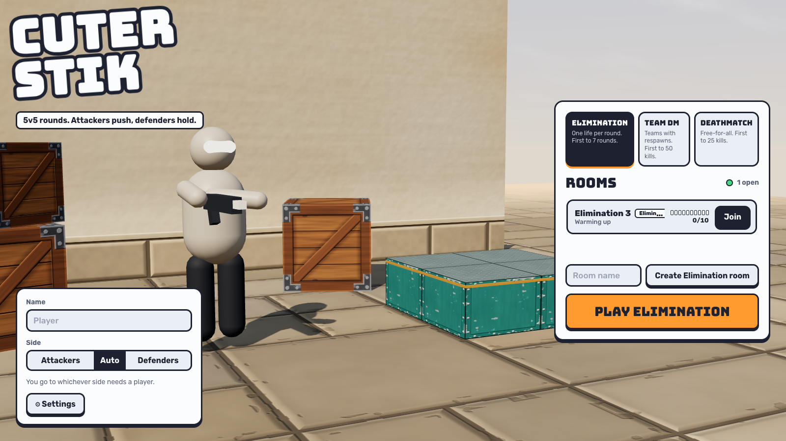

# Cuter Stik

Multiplayer cartoon FPS with three modes: Elimination (attackers vs defenders, bomb objective and round economy), Team Deathmatch and free-for-all Deathmatch. Five weapons with spray patterns, crouch, sprint and slide, lag-compensated hitscan and synthesized sound.


| Lobby | Settings |
| --- | --- |
|  |  |

```
├── shared/   Rust: constants, map, movement, hitscan, protocol (native + wasm)
├── server/   Rust: axum WebSocket server, 64-tick rooms, round rules
└── client/   Vite + React + React Three Fiber, imports shared as WASM
```

## Requirements

- Rust (stable) with the wasm target: `rustup target add wasm32-unknown-unknown`
- [wasm-pack](https://github.com/drager/wasm-pack): `cargo install wasm-pack`
- Node 20+

## Run (dev)

```sh
# terminal 1: game server on :8080
cargo run -p server

# terminal 2: client on :5173 (builds the wasm first, proxies /ws to :8080)
cd client && npm install && npm run dev
```

Open two browser tabs to get one player per team: the first round starts once both teams have someone.

The lobby lists open rooms (`GET /api/rooms`, polled every 2 s). From it you can quick play (joins the busiest room with space), join a listed room, or create a named one, and pick a side: Attackers, Defenders or Auto. A side preference is honored unless that team already has more players.

Controls: `WASD` move, `Space` jump (hold to bunny-hop), `Shift` sprint (forward only, firing drops you to a run), `Alt` walk, `C` crouch (press while running to slide instead: speed boost, hold to keep sliding, jump out to keep the momentum; you stay crouched when it ends), mouse to aim and shoot, right mouse to scope (sniper), `R` reload, `1` / `2` / `Q` / mouse wheel switch weapons, `B` buy menu, `E` (hold) plant or defuse, `Tab` scoreboard, `Esc` pause.

Walking (`Alt`) and crouching are silent; running makes footsteps that other players hear from where you are.

Settings (lobby ⚙ button, or `Esc` → Settings in game) cover sensitivity, invert Y, volume, render quality, shadows, a fully custom crosshair and the minimap. They're saved in `localStorage`.

The minimap (top left) always shows teammates. Enemies appear only while someone on your team can actually see them (inside their view cone, clear line of sight, within 60 m), then leave a fading last-seen mark. It can rotate with your view or stay north-up, and follow you or show the whole map.

### Weapons and buying

| Weapon | Price | Mag | Notes |
| --- | --- | --- | --- |
| Pistol | default | 12 | semi-auto, one-taps an unarmored head |
| Hand Cannon | $700 | 7 | semi-auto, one-taps a helmet |
| SMG | $1250 | 30 | full auto, accurate on the move, $600 per kill |
| Rifle | $2700 | 30 | full auto, climbing spray that sways side to side |
| Sniper | $4750 | 5 | hold right mouse to scope, wildly inaccurate unscoped, slow to move with |

Kevlar ($650) and Kevlar + Helmet ($1000) absorb part of each hit; how much depends on the weapon's armor penetration. The head is only covered with a helmet.

Accuracy depends on how you move: standing or walking is accurate, running and jumping add spread, crouching tightens it. Holding the trigger climbs the weapon's recoil pattern; it recovers when you let go.

In Elimination you buy during freeze time and the first 20 s of the round, inside your spawn's buy zone. In warmup and the respawn modes everything is free and you can buy anywhere; what you pick is your loadout for every respawn (default: Rifle).

### Elimination: bomb and economy

- One attacker spawns with the bomb. Hold `E` standing still inside site A or B (the dashed circles on the minimap) for 3.2 s to plant. It goes off 40 s later (big damage within 14 m) for an attacker win.
- Defenders hold `E` within reach of the planted bomb for 6 s to defuse. Once it's planted, killing every attacker isn't enough: it still has to be defused.
- A dead carrier drops the bomb; any attacker walking over it picks it up.
- Money: $800 to start, $16000 max. Round win $3250; loss $1400 + $500 per consecutive loss (up to $3400); attackers get $800 extra for a lost round where they planted. Kills pay per weapon, planting and defusing pay $300.
- Survivors keep their weapons and armor into the next round; dying loses them.

## Checks

```sh
cargo test --workspace          # movement, weapons, hitscan, rounds, bomb, economy, lag compensation
cd client && npm run typecheck
cd client && npm run e2e        # two bots vs the running server
```

## Production

```sh
cd client && npm run build
cargo build --release -p server
STATIC_DIR=client/dist ./target/release/server   # serves the client and /ws on :8080
```

Env: `PORT` (default 8080), `STATIC_DIR`, `RUST_LOG` (default `server=info`).

## How it works

- **One simulation, two targets.** `shared::movement::step` (Source-style accel, friction, air-strafe, AABB collision) runs on the server natively and in the browser as wasm. All math goes through `libm`, so both builds give bit-identical results.
- **Client prediction.** `LocalSim` (wasm) applies each input immediately, keeps the unacknowledged ones, and on every snapshot resets to the server state and replays them. It predicts weapons too (`shared::weapons::Arsenal`: ammo, fire rate, reloads, switching, spray), so your shots, tracers and ammo count react instantly and match the server.
- **Deterministic spread.** Each shot's random spread comes from a hash of the shooter id and the input seq (`combat::shot_random`), so the client draws the same bullet the server traces.
- **Lag compensation.** Each input carries the server time the client was rendering remote players at (`view_time`). The server keeps 0.4 s of hitbox history and rewinds every target to that moment before tracing the shot, so you hit what you saw.
- **Remote players** are rendered ~100 ms in the past, interpolated between snapshots.
- **Server-authoritative.** The client sends only inputs (`seq`, move axes, buttons, yaw/pitch). The server applies at most 2 inputs per player per tick and advances weapon timers per input, so sending inputs faster can't buy speed or fire rate.
- **Protocol.** `postcard` binary over WebSocket. Input ≈ 15 bytes. TS types in `client/src/net/protocol.ts` mirror `shared/src/protocol.rs`.
- **Modes.** All share one phase machine: Warmup (free respawns until enough players) → Freeze (3 s) → Live → Match end (8 s scoreboard) → next match.
  - *Elimination*: 1:55 rounds, one life, eliminate the other team (time-out = defender win). First to 7 rounds. Mid-round joiners spawn next round.
  - *Team Deathmatch*: 10 min, respawn after 2.5 s, first team to 50 kills.
  - *Deathmatch*: free-for-all, 8 min, first to 25 kills. Respawns pick the spawn farthest from everyone alive.
  - Deathmatch respawns get 1.5 s of spawn protection, which ends early if you fire.
- **Sprint / slide / crouch** live in `shared::movement`, so they're predicted like everything else. Crouching shrinks the collision box and hitboxes; you only stand up where there's headroom.
- **Stairs and ramps.** Movement steps up ledges up to 0.42 m and sticks to the ground going down, Source-style. Ramps (`map::RAMPS`) collide as a stack of thin steps and render as smooth wedges.
- **Sound** is synthesized with Web Audio (`client/src/game/audio.ts`, no asset files) and positioned in 3D: gunshots per weapon, footsteps, landings, reloads, bomb beeps that speed up, the explosion, hit and kill confirmations.

## Not done yet

- Grenades, defuse kits, picking up dropped weapons
- Halftime side swap
- Crouch-jumping onto ledges higher than a normal jump (crouching mid-air doesn't lift your legs)
