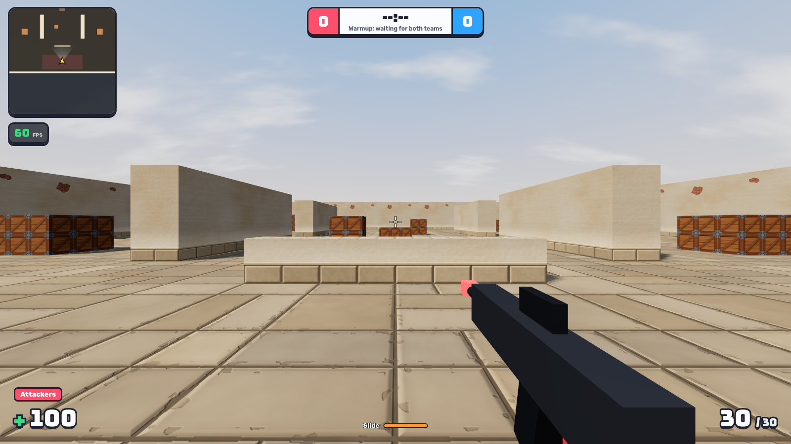
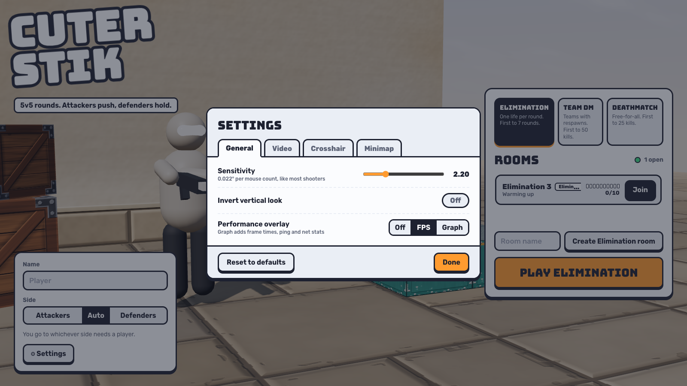

# Cuter Stik

Multiplayer cartoon FPS with three modes: Elimination (attackers vs defenders, rounds), Team Deathmatch and free-for-all Deathmatch. Hitscan, sprint and slide.



| Lobby | Settings |
| --- | --- |
|  |  |

```
├── shared/   Rust: constants, map, movement, hitscan, protocol (native + wasm)
├── server/   Rust: axum WebSocket server, 64-tick rooms, round rules
└── client/   Vite + React + React Three Fiber, imports shared as WASM
```

## Requirements

- Rust (stable) with the wasm target: `rustup target add wasm32-unknown-unknown`
- [wasm-pack](https://github.com/drager/wasm-pack): `cargo install wasm-pack`
- Node 20+

## Run (dev)

```sh
# terminal 1: game server on :8080
cargo run -p server

# terminal 2: client on :5173 (builds the wasm first, proxies /ws to :8080)
cd client && npm install && npm run dev
```

Open two browser tabs to get one player per team: the first round starts once both teams have someone.

The lobby lists open rooms (`GET /api/rooms`, polled every 2 s). From it you can quick play (joins the busiest room with space), join a listed room, or create a named one, and pick a side: Attackers, Defenders or Auto. A side preference is honored unless that team already has more players.

Controls: `WASD` move, `Space` jump (hold to bunny-hop), `Shift` sprint (forward only, firing drops you to a run), `C` slide (press while sprinting for a speed boost; hold to keep sliding, jump out to keep the momentum), `Alt` walk, mouse to aim and shoot, `R` reload, `Tab` scoreboard, `Esc` pause.

Settings (lobby ⚙ button, or `Esc` → Settings in game) cover sensitivity, invert Y, FOV, render quality, shadows, a fully custom crosshair and the minimap. They're saved in `localStorage`.

The minimap (top left) always shows teammates. Enemies appear only while someone on your team can actually see them (inside their view cone, clear line of sight, within 60 m), then leave a fading last-seen mark. It can rotate with your view or stay north-up, and follow you or show the whole map.

## Checks

```sh
cargo test --workspace          # movement, hitscan, protocol
cd client && npm run typecheck
cd client && npm run e2e        # two bots vs the running server
```

## Production

```sh
cd client && npm run build
cargo build --release -p server
STATIC_DIR=client/dist ./target/release/server   # serves the client and /ws on :8080
```

Env: `PORT` (default 8080), `STATIC_DIR`, `RUST_LOG` (default `server=info`).

## How it works

- **One simulation, two targets.** `shared::movement::step` (Source-style accel, friction, air-strafe, AABB collision) runs on the server natively and in the browser as wasm. All math goes through `libm`, so both builds give bit-identical results.
- **Client prediction.** `LocalSim` (wasm) applies each input immediately, keeps the unacknowledged ones, and on every snapshot resets to the server state and replays them.
- **Remote players** are rendered ~100 ms in the past, interpolated between snapshots.
- **Server-authoritative.** The client sends only inputs (`seq`, move axes, buttons, yaw/pitch). The server applies at most 2 inputs per player per tick and advances weapon timers per input, so sending inputs faster can't buy speed or fire rate.
- **Protocol.** `postcard` binary over WebSocket. Input ≈ 15 bytes. TS types in `client/src/net/protocol.ts` mirror `shared/src/protocol.rs`.
- **Modes.** All share one phase machine: Warmup (free respawns until enough players) → Freeze (3 s) → Live → Match end (8 s scoreboard) → next match.
  - *Elimination*: 1:55 rounds, one life, eliminate the other team (time-out = defender win). First to 7 rounds. Mid-round joiners spawn next round.
  - *Team Deathmatch*: 10 min, respawn after 2.5 s, first team to 50 kills.
  - *Deathmatch*: free-for-all, 8 min, first to 25 kills. Respawns pick the spawn farthest from everyone alive.
  - Deathmatch respawns get 1.5 s of spawn protection, which ends early if you fire.
- **Sprint / slide** live in `shared::movement`, so they're predicted like everything else. Slide state travels in each snapshot so replays stay exact.

## Not done yet

- Lag compensation (rewinding hitboxes to what the shooter saw)
- Bomb objective, economy/buy menu, multiple weapons, spread/recoil patterns
- Crouch, ramps/stairs (collision is axis-aligned boxes only)
- Sounds
